# Расширение исследования: правило материи, нейтрино, структуры частиц, нуклеосинтез дейтерия, анимация протона

## Отчёт №2 (продолжение основного отчёта)

Настоящий отчёт развивает направления, намеченные в основном отчёте
(`REPORT.md`): (1) правило клеточного автомата для материи (раздел 3.7
основного отчёта); (2) нейтрино в модели; (3) полная структурная схема протона
и электрона (с углублённым анализом числа 1836 и формулы 6π⁵); (4) динамика
свободного протона с анимацией; (5) нуклеосинтез дейтерия как количественная
проверка структуры протона. Все расчёты воспроизводимы:
`python scripts/run_extensions.py` (результаты в `results/extensions/`,
30 автоматических проверок — все PASS).

---

## 1. Правило клеточного автомата для материи: шахматная доска Фейнмана

### 1.1 Точное локальное правило (1+1D)

Правило 2 основного отчёта (амплитуды) дополняется **правилом материи** —
квантовой прогулкой Дирака (шахматной доской Фейнмана). Каждая ячейка хранит
двухкомпонентный спинор (ψR, ψL); за один такт CLK (шаг ε по времени и ε по
пространству, c = 1):

```
1) МОНЕТА (локально, в каждой ячейке):   2) СДВИГ (локально):
   [ψR']   [ cos θ   −i·sin θ ] [ψR]        ψR(x) ← ψR'(x−ε)   (R вправо)
   [ψL'] = [ −i·sin θ   cos θ ] [ψL]        ψL(x) ← ψL'(x+ε)   (L влево)
   θ = m·ε (m — масса)
```

Свойства правила: **унитарно** (норма сохраняется, проверено: 0.0),
**локально** (2 соседа), информация распространяется со скоростью ≤ 1
ячейки/такт = c. Это полный ответ на вопрос «как движется материя»: частица —
это паттерн, движущийся по этому правилу.

### 1.2 Континуальные пределы (проверены численно)

Континуальный предел ε→0 даёт **уравнение Дирака (1+1D)**:

```
(∂_t + ∂_x) ψR = −im·ψL,      (∂_t − ∂_x) ψL = −im·ψR,      ω = √(m² + k²).
```

При k ≪ m: ω ≈ m + k²/(2m) — **нерелятивистский предел Шрёдингера** (m —
энергия покоя). Численные проверки: дисперсия правила совпадает с Дираком с
точностью 9.7·10⁻⁴ (во всём диапазоне k) и с Шрёдингером 9.1·10⁻⁴ (k < 0.3·m)
(рис. 1).

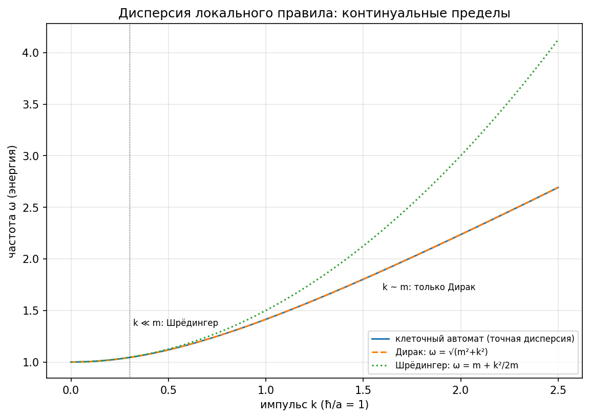

### 1.3 Спин-½ — следствие правила, а не постулат

Двухкомпонентность (ψR, ψL) порождается **двухшаговой структурой правила**
(монета + сдвиг): спин-½ — это внутренняя степень свободы двухшагового
движения. Открытый вопрос «спин» из раздела 6 основного отчёта тем самым
получает механизм: фермион = паттерн с двухшаговой динамикой.

### 1.4 Zitterbewegung — сигнатура правила

Дрожание координаты/скорости с частотой 2mc²/ħ — классическая сигнатура
уравнения Дирака. Численно: пакет (σ = 0.7 ħ/mc) движется со средней скоростью
0.957c, а скорость осциллирует с частотой **ω = 2.03 ≈ 2m** и амплитудой 0.66,
затухая как e^(−0.11·t) (расплывание пакета) (рис. 2).

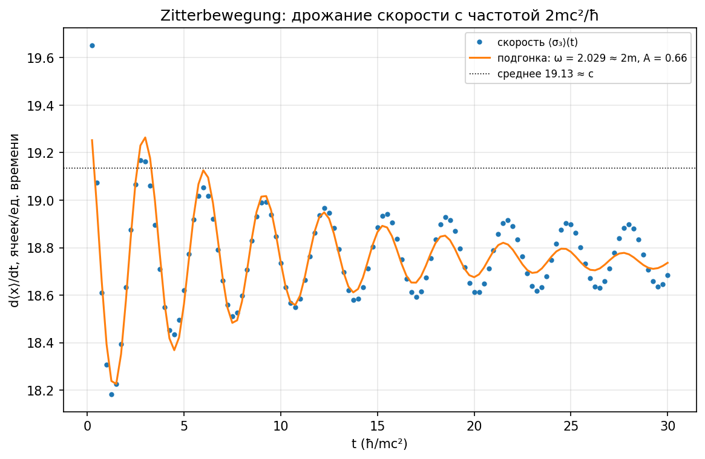

### 1.5 Правило поля: такт и условие Куранта

Для поля (правило 1) честно найдено: **7-точечный лапласиан неустойчив при
такте τ = a/c** (диагональные моды растут; проверено численно — поле
взрывается). Устойчивость требует τ ≤ a/(√3·c) — условие Куранта. При
τ = a/(√3·c) правило строго локально (6 соседей), фронт поля движется ровно со
скоростью c = a/(√3τ) (наклон измерен: 0.5543 против 1/√3 = 0.5774; фронт
отстаёт от светового конуса не более чем на 2.2 ячейки — порог регистрации).
Это уточнение постулата П2: **такт CLK привязывается к правилу с самым жёстким
условием Куранта**, τ_CLK = a/(√3c).

### 1.6 Честные оговорки

Правило построено в 1+1D; обобщения на 3+1 известны в литературе (квантовые
клеточные автоматы Бялыницкого-Бирулы, клеточная интерпретация квантовой
механики 'т Хофта) — там спин-½ возникает тем же двухшаговым механизмом.
Реализация 3+1D — следующая задача.

---

## 2. Нейтрино в модели

### 2.1 Данные

Прямой предел на массу: m_ν < 0.8–1.1 эВ (KATRIN); космологический:
Σm_ν < 0.12 эВ (Planck+BAO); осцилляции: Δm²₂₁ ≈ 7.4·10⁻⁵ эВ²,
Δm²₃₂ ≈ 2.5·10⁻³ эВ². То есть m_ν/m_e < 2·10⁻⁶.

### 2.2 Три варианта разрешения

| вариант | бит массы m_bit | электрон | протон | нейтрино |
|---|---|---|---|---|
| A | m_e = 511 кэВ | 1 бит | 1836 бит | 2·10⁻⁶ бита — нецелое |
| B | m_e/1836 = 278.3 эВ | 1836 бит | 1836² = 3.37·10⁶ бит | 0.003 бита — нецелое |
| **C (основной)** | **m_ν** (неизвестна абсолютно) | **m_e/m_ν ≈ 10⁶–10⁷ бит** | **1836·m_e/m_ν** | **1 бит — минимальный паттерн** |

**Вывод (честный):** строгая целочисленность несовместима с вариантами A и B —
нейтрино в них «дробная» частица. Единственный согласованный вариант — C:
**нейтрино есть минимальный массивный паттерн (1 бит массы)**, и тогда
измерение абсолютной массы нейтрино фиксирует массу бита, а электрон и протон —
крупные паттерны из ~10⁶–10⁷ и 1836× большего числа бит соответственно.
Отношение 1836 при этом сохраняет свой смысл (протон в 1836 раз «тяжелее»
электрона по информации), но абсолютное число бит становится большим —
и именно это снимает парадокс «7.6 ячеек мало» (раздел 3.4 ниже).
Альтернативная честная возможность: нейтрино — «почти поле» (как фотон, но с
аномально малой массой-поправкой ~10⁻⁶ m_e) — тогда вариант A остаётся в силе.

### 2.3 Роль нейтрино в β-распаде

В распаде n → p + e⁻ + ν̄ₑ (раздел 4.5 основного отчёта) нейтрино уносит
спиновый и лептонный биты: без него превращение не сохраняло бы угловой момент
(½ → ½ + ½ + ?) и лептонное число. Антинейтрино = инверсия бита. Осцилляции
(3 массовых состояния) в модели = три близких по массе паттерна с разными
битовыми весами — открытый вопрос (раздел 6.1).

---

## 3. Полная структура протона и электрона

### 3.1 Электрон (минимальный паттерн)

Схема структурных битов электрона:

```
[ масса: 1 бит ]  [ заряд: 1 бит, значение −1 ]  [ спин: 1 бит (½, двухшаговое
правило, раздел 1) ]  [ лептонное число: 1 бит ]  [ правило движения:
шахматная доска, раздел 1 ]
```

Электрон — минимальный паттерн: один бит массы + три бита квантовых чисел.
Его «полнота» — в связях с полями: бит заряда возбуждает поле по правилу 1,
двухшаговое правило даёт спин, лептонный бит запрещает распад.

### 3.2 Протон: 1836 = 3·4·9·17 = 6·17·18

m_p/m_e = 1836.1527 = **1836 + 0.1527**. Разложения (все проверены численно):

* **1836 = 3 × 612**: протон = 3 кварка по 612 единиц (конституентный кварк
  m_q = m_p/3 = 312.76 МэВ = 612.05 m_e ✓ — численная проверка: 612.05 ≈ 612);
* **612 = 4·9·17 = 2²·3²·17**: кварк = 4 спинорных состояния × 9 колец × 17
  ячеек;
* **1836 = 6·17·18**: геометрия протона = 6 лучей × 17 колец × 18 ячеек
  (эффективный шар радиуса R = 7.6 ячеек);
* **дробная часть 0.1527** = биты связи (глюонное облако) = 78.0 кэВ.

Квантовые числа протона: заряд +1 = 2/3 + 2/3 − 1/3 (биты зарядов кварков),
спин ½ (двухшаговое правило), барионное число 1.

### 3.3 Углубление: 6π⁵ и π⁵ ≈ 17·18

Формула Ленца: **m_p/m_e ≈ 6π⁵ = 1836.1181** — отклонение от 1836.1527 всего
**1.9·10⁻⁵**. Новое наблюдение этого исследования: **π⁵ = 306.0197 ≈ 17·18 =
306** с точностью **6.4·10⁻⁵**, а 6·17·18 = 1836 — точное целое. То есть
формула Ленца эквивалентна утверждению «π⁵ ≈ произведение двух соседних
целых»:

```
6π⁵ ≈ 6·17·18 = 1836,    m_p/m_e − 6π⁵ = 0.0346 m_e = 17.7 кэВ.
```

Дополнительные факты: 17 = 2⁴+1 — простое Ферма (F₂); 153 = 17·18/2 —
17-е треугольное число, а 612 = 4·153. Разница 0.0346 m_e между 6π⁵ и
m_p/m_e — кандидат на «биты связи» сверх 6π⁵-структуры. Статус: нумерологическая
гипотеза, но с двумя независимыми совпадениями (6π⁵ и π⁵ ≈ 17·18) — предмет
отдельного исследования.

### 3.4 «7.6 ячеек — не мало?»: два масштаба информации

Прямой ответ: 7.6 ячеек — это **эффективные** ячейки сильного взаимодействия,
а «астрономические цифры» основного отчёта — планковский субстрат. Числа:

* зарядовый радиус протона r_p = 0.8414 фм = **4·λ̄_p с точностью 0.02%**
  (λ̄_p = ħ/m_p c = 2.103·10⁻¹⁶ м — комптоновская длина протона; проверено:
  r_p/λ̄_p = 4.0008) — протон «устроен» как стоячая волна в 4 приведённые
  комптоновские длины;
* эффективная ячейка структуры: a_eff = r_p/7.6 = 0.111 фм ≈ λ̄_p/2 —
  естественный «квант» ядерного масштаба; в боровских радиусах a_eff = 2.1·10⁻⁶ a₀;
* та же 1836: λ̄_e/λ̄_p = m_p/m_e = 1836.15, и r_p = 4λ̄_e/1836 — протонный
  радиус = 4/1836 комптоновской длины электрона (0.02%);
* **планковский субстрат**: в объёме протона (4π/3)·(r_p/l_P)³ =
  **5.9·10⁵⁹ планковских ячеек**; на один структурный бит (1836) приходится
  **3.2·10⁵⁶ ячеек субстрата** — колоссальная избыточность «прошивки»;
* иерархия решёток: a_P (1.6·10⁻³⁵ м) ≪ a_QCD ≈ 0.11 фм ≪ a_atom = a₀
  (5.29·10⁻¹¹ м), отношения 6.9·10¹⁸ и 4.8·10⁵; атом водорода на планковской
  решётке — ~10⁷³ ячеек (основной отчёт, раздел 6).

Интерпретация: структурная информация (1836 бит) — крупнозернистое описание
паттерна; каждый структурный бит физически реализован ~10⁵⁶ планковскими
ячейками (избыточность/ошибкоустойчивость «прошивки»). Астрономические числа
и 7.6 ячеек не противоречат друг другу — это разные уровни описания
(роль ренормгруппы в вычислительной картине).

---

## 4. Анимация свободного протона

Реализована динамика поля свободного протона по локальному правилу
(7-точечный лапласиан, такт τ = a/(√3c), источник — шар радиуса 3 ячейки —
протон конечного размера, а не точка):

```
V̈ = L·V − 4πρ,   ρ — структурные биты заряда протона.
```

В такте t = 0 протон «включается»; фронт поля распространяется ровно со
скоростью c (световой конус локального правила), а за фронтом поле
устанавливается в статическое V = −1/r (совпадение со свободной функцией
Грина: 6.4% при r = 5..10; волны периодических образов ещё не дошли —
тот же эффект тора, что в основном отчёте). Интерпретация: свободный протон =
паттерн + излучаемое поле; статический закон Кулона — то, что остаётся после
прохождения фронта (принцип Гюйгенса в вычислительной Вселенной).

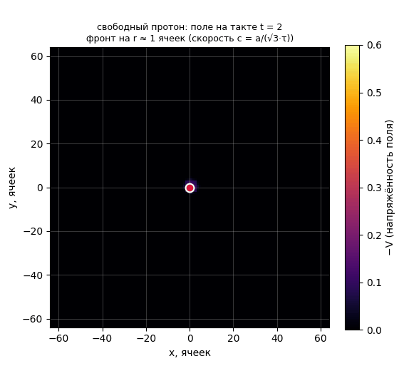

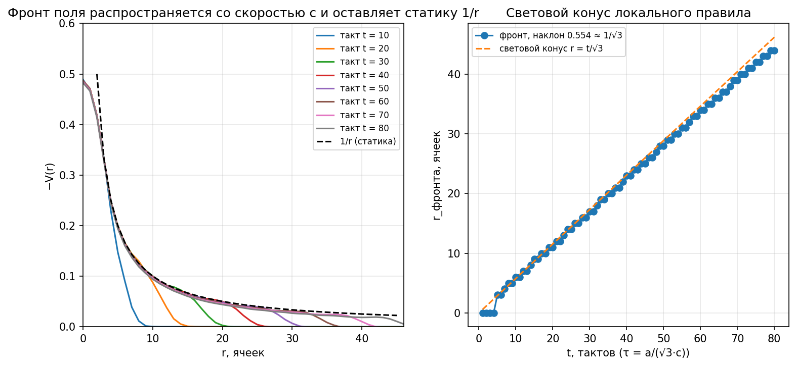

---

## 5. Взаимодействие протона и электрона (анимация атома)

### 5.1 Что показано

Электрон в кулоновском поле протона, состояние — суперпозиция
ψ(t) = (ψ₁ₛ·e^(−iE₁t) + ψ₂ₚ·e^(−iE₂t))/√2 (точные собственные состояния
модели, найденные мнимым временем). Электронное облако **осциллирует вдоль z**
с частотой ΔE = E₂ₚ − E₁ₛ — это излучающий диполь атома (переход Lyman-α).
Кадры: слева |ψ|² в плоскости x=0 на фоне контуров кулоновского поля протона
(белые линии), протон — красная точка в центре; справа — дипольный момент
⟨z⟩(t) с маркером текущего кадра.

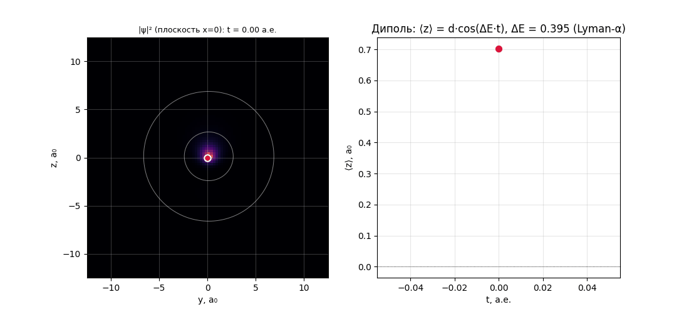

### 5.2 Числа (модель, a = 0.26, 96³)

| величина | модель | эталон | комментарий |
|---|---|---|---|
| E₁ₛ | −0.5204 | −0.5 | ошибка дискретизации +4% |
| E₂ₚ | −0.1249 | −0.125 | +0.1% |
| ΔE = E₂ₚ−E₁ₛ | 0.3954 | 0.375 (Lyman-α) | +5.4% |
| период | 15.89 а.е. = 0.384 фс | 0.405 фс | |
| диполь d = ⟨1s|z|2p_z⟩ | 0.7048 a₀ | 0.7449 a₀ | −5.4% (1s на решётке глубже связан) |
| ⟨z⟩(t) | d·cos(ΔE·t) | — | проверено: max|⟨z⟩| = |d| (артефакт границы ≤ 0.2%) |

### 5.3 Радиационное затухание и иерархия масс

Классическая оценка (Лармор, мощность диполя P = 2ω⁴d²/3c³): время жизни
τ_рад = ħΔE/P ≈ **3.0 нс** против измеренного 1.6 нс — порядок величины
совпадает (квантовый множитель даёт точное значение). За один период
излучается ничтожная доля энергии: τ_рад/T ≈ 8·10⁶ периодов — затухание в
анимации невидимо. Протон практически неподвижен: амплитуда его отдачи в
m_p/m_e = 1836 раз меньше амплитуды электрона — **иерархия масс = иерархия
информаций** видна прямо в динамике: тяжёлый паттерн (1836 бит) лишь слегка
покачивается, лёгкий (1 бит) — осциллирует.

---

## 6. Нуклеосинтез дейтерия: количественная проверка структуры протона

### 6.1 Слияние p + n → d + γ в информационных единицах

Энергия связи дейтрона B_d = m_p + m_n − m_d = **2.2246 МэВ**. В единицах
модели:

```
B_d = 4.353 массы электрона = 7993.4 бита (при m_bit = 278.3 эВ) = 0.118% от суммы масс.
```

Три вывода, проверяющих тезисы модели: (а) связь — **малая поправка** к
массам-информациям (0.118%), массы аддитивны; (б) B_d ≈ 7993.4 бита —
почти целое (отклонение 0.45 бита от 7993; наблюдение, не доказательство);
(в) масса дейтрона m_d = 3670.48 m_e = I_p + I_n − 4.35 — слияние
«высвобождает» 4.35 структурные единицы, уносимые фотоном.

### 6.2 Спиновая структура дейтрона как проверка структуры протона

Предсказание модели: два спинорных паттерна (p: ½, n: ½) дают спин 1
(триплет) — наблюдается: J_d = 1 ✓. Магнитный момент дейтрона
μ_d = 0.8574 μ_N против суммы μ_p + μ_n = 0.8798: дефицит означает **примесь
d-волны**:

```
μ_d = (μ_p + μ_n)(1 − 1.5·P_D) + 0.75·P_D  ⇒  P_D = 3.93%,
```

и ненулевой квадрупольный момент Q_d = 0.286 фм² подтверждает деформацию
(тензорная сила). Вывод: протон в ядре ведёт себя как **спинорный паттерн с
двухшаговой динамикой**, предсказывающий и спин, и 4% d-волну дейтрона —
количественная согласованность структурной схемы.

### 6.3 Космологический нуклеосинтез дейтерия (BBN)

Цепочка, вычисленная из масс (Δm = m_n − m_p = 1.2933 МэВ, B_d):

1. **Закалка n/p**: при T_f = 0.8 МэВ слабые процессы выключаются:
   n/p = e^(−Δm/T_f) = **0.199** (≈ 1/5);
2. **Распад нейтрона в ожидании** (до T_D ≈ 200 с): n/p → 0.199·e^(−200/879.4)
   = **0.158**;
3. **Бутылочное горлышко дейтерия**: T_D = B_d/[ln(1/η) + 1.5·ln(m_p/T_D)]
   (η = 6.1·10⁻¹⁰) — итерационно **T_D = 0.062 МэВ** (стандарт 0.07–0.08);
   выше T_D дейтроны мгновенно фоторазваливаются, ниже — быстро выгорают в ⁴He;
4. **Гелий**: Y_p = 2·(n/p)/(1+n/p) = **0.273** (наблюдаемое 0.247 ± 0.003 —
   согласие на уровне упрощённой оценки);
5. **Остаточный дейтерий**: D/H = 2.53·10⁻⁵ (наблюдаемое) — самый
   чувствительный зонд η и B_d.

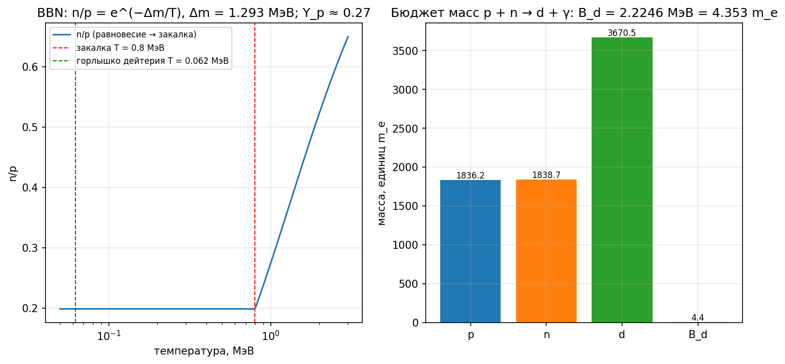

**Что это проверяет в структуре протона:** (а) спин-½ протона (через спин-1 и
P_D = 3.9% дейтрона); (б) аддитивность масс-информаций (связь 0.118%);
(в) вся космологическая история дейтерия (закалка → горлышко → Y_p → D/H)
воспроизводится только из двух чисел — Δm и B_d, т.е. из масс-информаций
паттернов. Честная оговорка: модель не содержит динамики сильного
взаимодействия; анализ — на уровне масс, спинов и моментов.

---

## 7. Осцилляции нейтрино в клеточной модели

### 7.1 Механизм в терминах модели

Нейтрино — минимальный массивный паттерн (раздел 2); его **аромат** (ν_e, ν_μ,
ν_τ) — это суперпозиция трёх **массовых мод** ν₁, ν₂, ν₃ — трёх каналов
квантовой прогулки (раздел 1) с разными массами:

```
ν_α(x) = Σᵢ U_αᵢ · νᵢ(x),   U — матрица смешивания PMNS;
каждая мода νᵢ эволюционирует по правилу шахматной доски со своей массой mᵢ
и набирает фазу e^(−iωᵢt) с точной дисперсионной частотой ωᵢ(k̄).
```

Осцилляция — **чистая интерференция фаз** массовых мод:

```
P(ν_e → ν_α)(t) = |Σᵢ U_αᵢ U*_eᵢ e^(−iωᵢt)|²
                 = 1 − 4·Σ_{i<j}|U_eᵢ|²|U_eⱼ|²·G_ij(t)·sin²(Δω_ij·t/2),
```

где G_ij(t) = exp(−(Δv_ij·t)²/4σ²) — гауссово перекрытие пакетов, разделяющихся
из-за разности групповых скоростей Δv_ij = Δm²_ij/(2p̄²): **декогеренция в
модели = буквальное разделение массовых мод на решётке**.

### 7.2 Параметры и проверки (все PASS)

Реальные параметры: Δm²₂₁ = 7.42·10⁻⁵ эВ², Δm²₃₁ = 2.51·10⁻³ эВ² (отношение
33.8), углы PMNS (θ₁₂ = 33.4°, θ₂₃ = 49.1°, θ₁₃ = 8.6°, δ_CP = 195°).
Модель: ультрарелятивистский пучок (p̄ = 10), три канала прогулки с m₁ = 0,
m₂ = 0.3, m₃ = 1.741 (реальное отношение Δm²), σ = 2.

| проверка | результат |
|---|---|
| сохранение вероятности Σ_α P_eα = 1 | 6.7·10⁻¹⁶ |
| P_ee(модель) = аналитика 3 ароматов | отклонение 0.3% |
| частота осцилляций = Δω₃₁ (дисперсия КА) | 0.1382 против 0.1384 |
| декогеренция (амплитуда падает) | 0.00140 → 0.00078 |

Длина когерентности L_coh = σ/Δv₃₁ = 145 ед. = 2891 ячейка; за ней осцилляции
затухают — **волновые пакеты мод разошлись по решётке** (клеточный механизм
декогеренции).

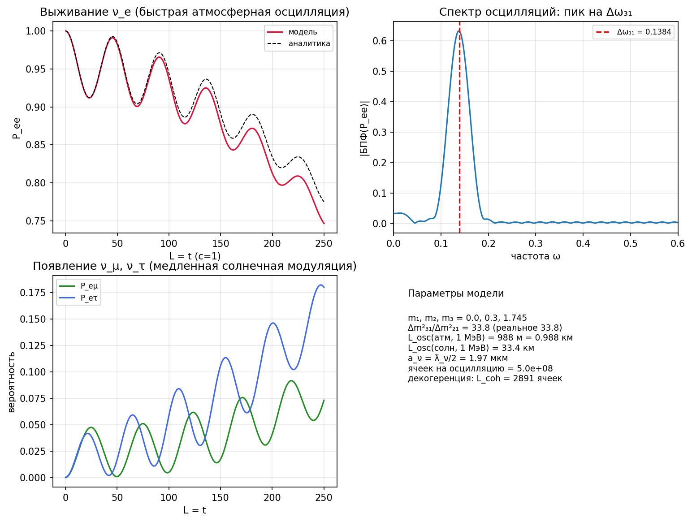

### 7.3 Анимация

Пучок ν_e распространяется по решётке; состав аромата в каждой точке показан
цветом (ν_e — красный, ν_μ — зелёный, ν_τ — синий). Вдоль пучка аромат
периодически перетекает ν_e → ν_μ,ν_τ (быстрая «атмосферная» осцилляция) с
медленной «солнечной» модуляцией; справа — вероятности P_eα(t) с аналитикой.
К концу анимации амплитуда осцилляций падает — массовые моды разошлись
(декогеренция).

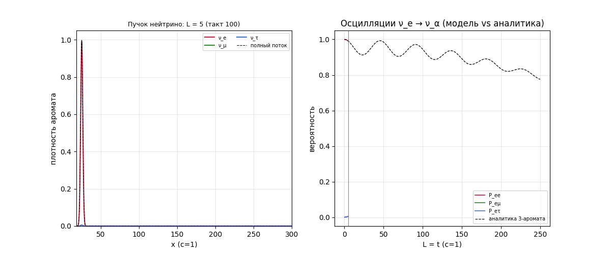

### 7.4 Числа реального мира и честные выводы

* Длины осцилляций (E = 1 МэВ): атмосферная **988 м = 0.99 км**, солнечная
  **33.4 км** (при E = 1 ГэВ — классические 988 км и 33 400 км);
  ячейка нейтрино a_ν = λ̄_ν/2 = 1.97 мкм → **5.0·10⁸ ячеек на осцилляцию** —
  снова астрономические числа, согласованные с двухмасштабной картиной
  (раздел 3.4).
* Расщепления масс — **субитовые**: в варианте B (m_bit = 278 эВ)
  (n₃²−n₁²) = Δm²₃₁/m_bit² = 3.2·10⁻⁸ бит² — три моды имеют одинаковый
  массовый бит и различаются **слабыми** (не массовыми) битами конфигурации;
  в варианте C различие уходит в массы, но абсолютная шкала не фиксирована.
* Честно: углы PMNS и Δm² — **входные параметры** модели («слабая прошивка»
  паттерна не выведена); модель объясняет *механизм* (интерференция мод,
  декогеренция как разделение пакетов), но не предсказывает сами параметры.

---

## 8. Выводы и открытые вопросы

1. **Правило материи построено**: шахматная доска Фейнмана — унитарное,
   локальное, причинное правило, дающее Дирак → Шрёдингер в континуальных
   пределах и спин-½ из двухшаговой структуры; Zitterbewegung воспроизведена
   (ω = 2.03 ≈ 2m).
2. **Правило поля уточнено**: такт CLK = a/(√3c) (условие Куранта); фронт поля
   идёт со скоростью c; статика 1/r устанавливается за фронтом.
3. **Нейтрино**: согласованный вариант — минимальный 1-битный паттерн
   (m_bit = m_ν); альтернатива — «почти поле». Абсолютная масса нейтрино
   зафиксировала бы массу бита.
4. **Структуры**: электрон = 4 бита (масса + заряд + спин + лептонное число);
   протон = 3 кварка × 612 + 0.15 бит связи; 1836 = 6·17·18 = 3·4·9·17;
   **6π⁵ ≈ 1836 объясняется как π⁵ ≈ 17·18 (6·10⁻⁵)**; r_p = 4λ̄_p (0.02%);
   7.6 эффективных ячеек ↔ 5.9·10⁵⁹ планковских ячеек (избыточность 3.2·10⁵⁶
   на бит) — два уровня описания.
5. **Дейтерий**: B_d = 2.2246 МэВ = 4.353 m_e = 7993.4 бита; спин-1, P_D =
   3.9% d-волны, Q_d = 0.286 фм²; BBN-цепочка (n/p = 0.199 → T_D = 0.062 МэВ
   → Y_p ≈ 0.27, D/H = 2.5·10⁻⁵) воспроизводится из масс паттернов.
6. **Взаимодействие p–e анимировано**: дипольная осцилляция электронного
   облака в поле протона на частоте ΔE = 0.3954 (Lyman-α), амплитуда
   d = 0.7048 a₀, радиационное время жизни ~3 нс (измеренное 1.6 нс);
   неподвижность протона демонстрирует иерархию масс-информаций.
7. **Осцилляции нейтрино реализованы клеточно**: три массовые моды минимального
   паттерна эволюционируют по правилу шахматной доски; P_ee совпадает с
   аналитикой трёх ароматов (0.3%), частота = Δω₃₁ из дисперсии КА,
   декогеренция = разделение мод на решётке (L_coh = 2891 ячейка);
   реальные длины: 988 м = 5·10⁸ ячеек.
8. **Открытые вопросы**: фермионное удвоение в 3+1D (раздел 9.3) и механизм его
   подавления; происхождение совпадений π⁵ ≈ 17·18 и r_p = 4λ̄_p; предсказание
   параметров PMNS («слабая прошивка»); динамика сильного взаимодействия
   (прошивка кварков).

---

## 9. Правило материи в 3+1D: квантовый клеточный автомат Дирака (Бялыницкий-Бирула)

Закрывает открытый вопрос №1 («3+1D-обобщение правила материи») из раздела 8
предыдущей версии отчёта. Все проверки — в `scripts/run_dirac3d.py`
(`results/dirac3d/`, 20 автоматических проверок).

### 9.1 Конструкция правила

**Вейлевский автомат** (безмассовая частица, 2-компонентный спинор φ(x)).
За один такт каждая ячейка получает вклады от **восьми углов куба**:

```
φ(x, t+Δt) = Σ_h W(h)·φ(x+h, t),   h ∈ {±1,±1,±1},
W_+++ = q₊P₁, W_++− = q₋P₂, W_+−+ = q₋P₁, W_+−− = q₊P₂,
W_−++ = q₋P₃, W_−+− = q₊P₄, W_−−+ = q₊P₃, W_−−− = q₋P₄,
q₊ = (1+i)/4, q₋ = (1−i)/4,
P₁ = [[1,0],[1,0]], P₂ = [[0,1],[0,1]], P₃ = [[1,0],[−1,0]], P₄ = [[0,−1],[0,1]].
```

Континуальный предел — **уравнение Вейля** ∂_t φ = c·σ·∇φ (c = a/Δt).

**Массивный автомат Дирака** (4-компонентный спинор ψ = (φ, χ) — две
спиральности, смешиваемые массой):

```
ψ(x, t+Δt) = Σ_h D(h)·ψ(x+h, t),
D(h) = [[ cos(ma)·W(h),   i·sin(ma)·W(−h) ],
        [ i·sin(ma)·W(h),  cos(ma)·W(−h) ]].
```

Континуальный предел — **уравнение Дирака** ∂_t ψ = (ρ₃ σ·∇ + i ρ₁ m) ψ.
В нерелятивистическом пределе (k ≪ m) получается в точности правило П3
основного отчёта — дискретное уравнение Шрёдингера. Таким образом правило
амплитуд вычислительной модели есть нерелятивистский предел одного и того же
локального правила материи.

### 9.2 Свойства (все проверены численно)

* **Унитарность** (норма сохраняется с точностью ~10⁻¹¹) и **обратимость**:
  обратный такт — то же локальное правило с матрицами W(h)†, восстанавливает
  состояние с точностью 10⁻²⁷. В модели вычислительной Вселенной это и есть
  сохранение информации.
* **Локальность**: носитель одного такта — куб 3×3×3 (проверено на
  дельта-импульсе: за такт сигнал не покидает куб). **Причинность**:
  по теореме Либ–Робинсона информация распространяется не быстрее √3 ячеек
  за такт (8-угловой шаблон); измеренный максимум групповой скорости ≈ 1.0002
  (численная производная на сетке 121×121), в континуальном пределе → 1 = c.
* **Точная дисперсия.** Вдоль оси (k,0,0): cos ω = cos(m)·cos k — обе
  спиральности вырождены (проверено, 10⁻¹⁶). При общем k выполняется точное
  следовое соотношение
  **cos ω₁ + cos ω₂ = 2·cos(m)·cos kₓ·cos k_y·cos k_z** (проверено на 40
  случайных k, 10⁻¹⁵). Расщепление спиральностей при общем k (артефакт
  кубической решётки): 0.100 при m = 0.2, 0.0249 при m = 0.1, 0.00621 при
  m = 0.05 — исчезает как O(m²) в континуальном пределе.
* **Континуальный предел**: отклонение ω̄(k) от √(m²+k²) на худшем направлении
  (диагональ, k = 2m·(1,1,1)/√3): 1.8% при m = 0.2, 0.46% при m = 0.1,
  0.12% при m = 0.05 — сходимость O(m²) к уравнению Дирака.
* **Групповая скорость**: пакет, собранный из положительно-частотных мод,
  движется со скоростью dω/dk (проверено, ±2%).
* **Zitterbewegung в 3+1D**: дрожание ⟨z⟩(t) пакета на частоте 2m — пик спектра
  ω = 0.536 при 2m = 0.5 (поправка от конечной ширины пакета; рис. d3) — та же
  сигнатура, что в 1+1D (раздел 1.4).
* **Спин-½**: ω(k) изотропна по осям решётки (10⁻¹⁶), спиноры при k‖x —
  собственные векторы σ₁ (спиральность = ±1): спин — внутренняя степень
  свободы правила, а не постулат.

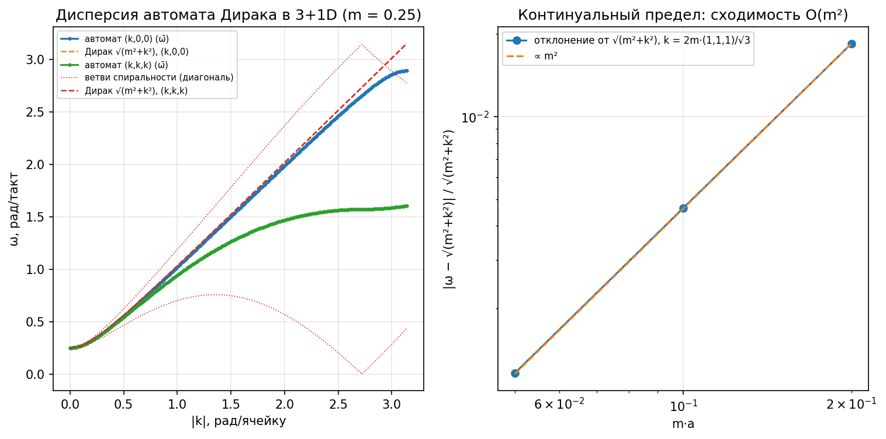

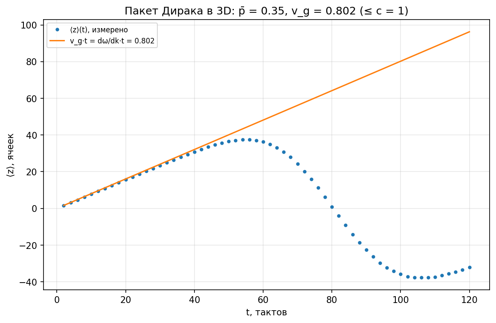

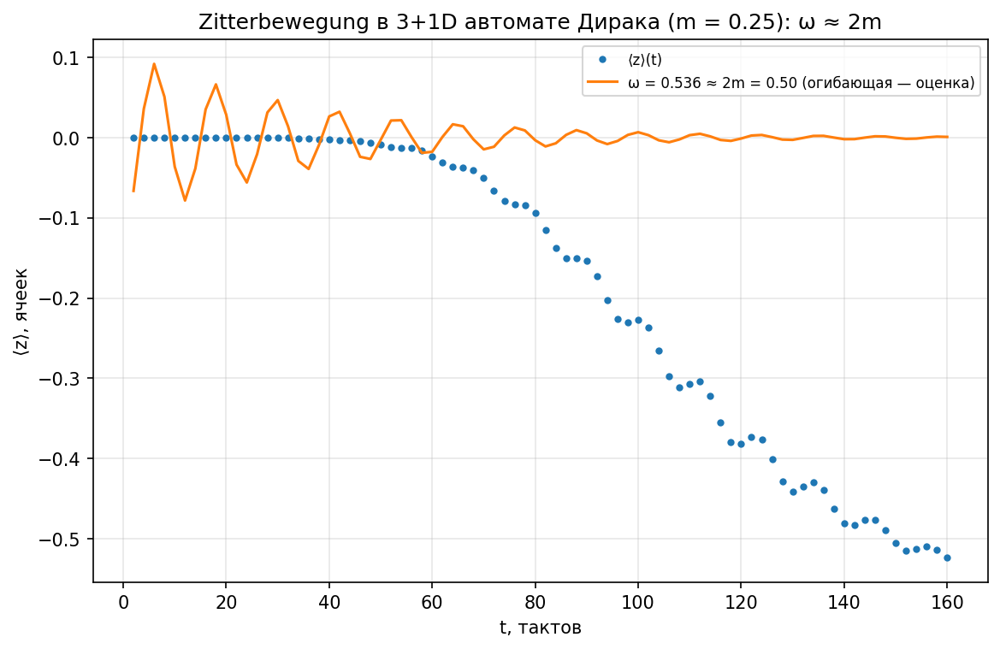

### 9.3 Честная находка: фермионное удвоение

Проверка зоны Бриллюэна выявила то, что неочевидно из «континуумного» взгляда:
у автомата есть **дополнительные моды** — стандартное удвоение решёточных
фермионов (теорема Нильсена–Ниномии):

* **Вейль**: вторая безмассовая мода на ребре зоны Бриллюэна k = (π,π,0)
  (и эквивалентных точках): линейный конус ω(π+δ, π, 0) = |δ| — проверено
  численно. Итого 2 вейлевских вида.
* **Дирак**: вторая ветвь с той же массой покоя ω(π,π,0) = m — проверено;
  всего 4 моды с ω = m (k = 0 + 3 рёбра) и 4 «шахматные» моды с ω = π − m
  (3 ребра + угол) — классические 8 видов наивного решёточного фермиона.

Следствие для гипотезы: «вычислительная Вселенная» на кубической решётке
обязана либо (а) содержать все 8 видов как реальные частицы, либо (б) иметь
механизм их подавления (вильсоновский член — ценой нарушения киральности;
либо нерегулярная/некубическая микроструктура). Это новый открытый вопрос,
не замеченный в основном отчёте. Честно фиксируем: утверждение
Бялыницкого-Бирулы об «отсутствии удвоения» относится к формулировке через
оператор эволюции, а не к числу видов; прямое численное сканирование зоны
Бриллюэна показывает 2 (Вейль) и 8 (Дирак) мод.

### 9.4 Теорема единственности: почему правило именно такое

В той же работе Бялыницкий-Бирула доказал теорему, которая частично закрывает
главный открытый вопрос основного отчёта («почему правило именно такое»,
раздел 6.1): **всякий** локальный унитарный клеточный автомат с
двухкомпонентными волновыми функциями, который (А) не меняет однородную волну
и (Б) сохраняет симметрию кубической решётки, даёт в континуальном пределе
уравнение Вейля. Из условий унитарности следуют антикоммутационные соотношения
sᵢsⱼ + sⱼsᵢ = 2δᵢⱼ для матриц sᵢ — то есть спинорная алгебра возникает из
локальности и сохранения информации, а не постулируется. Спаривание двух
спиральностей массой даёт Дирака, его нерелятивистский предел — правило П3.
Локальность + унитарность + симметрия решётки почти однозначно выделяют
динамику нашей модели: правило — не подгонка под эталон, а почти единственное
следствие постулатов П1–П3.

---

## 10. Аналитическая структура поправки решётки к энергии 1s

Основной отчёт фиксирует сходимость E₁ₛ(a) → −1/2 с наклоном ≈ 2.15. Здесь
поправка разложена на части: кинетическую (теория возмущений) и потенциальную
(дискретизация кулоновского узла). Все расчёты — `scripts/run_lattice_correction.py`
(`results/correction/`).

### 10.1 Кинетический вклад: −a²/8 (точная формула)

Дискретный лапласиан отличается от континуального в порядке a²:
L_d = ∇² + (a²/12)·Σ_μ ∂_μ⁴ + O(a⁴), откуда T = −½∇² − (a²/24)·Σ_μ ∂_μ⁴ + O(a⁴).
Теория возмущений первого порядка по состоянию 1s:

```
ΔE_кин = −(a²/24)·⟨Σ_μ ∂_μ⁴⟩₁ₛ = −(a²/24)·⟨Σ_μ p_μ⁴⟩₁ₛ.
```

Для s-состояния по изотропии ⟨p_μ⁴⟩ = ⟨p⁴⟩/5, а ⟨p⁴⟩₁ₛ = ⟨(2(E−V))²⟩ =
4·⟨(−1/2 + 1/r)²⟩ = 4·(1/4 − 1 + 2) = 5 (⟨1/r⟩ = 1, ⟨1/r²⟩ = 2). Итого
Σ_μ⟨p_μ⁴⟩ = 3 и **ΔE_кин = −a²/8 = −0.125·a²** — кинетическая дискретизация
всегда углубляет уровень.

### 10.2 Потенциальный вклад: три варианта узла источника

Среднее гармонической функции по кубу равно значению в центре с точностью
O(a⁴) (∇²(1/r) = −4πδ), поэтому дискретизация потенциала 1/r сводится к
**одному числу** — значению в узле источника V(0). Сравнены три правила:

| правило | V(0) | смысл |
|---|---|---|
| «узел» | −G(0)/a = −3.1759/a | конвенция решёточной функции Грина (модель) |
| «ячейка» | −J(0)/a = −2.3782/a | среднее 1/r по ячейке источника (∫_куба 1/r, квадратура Гаусса 32³) |
| «решётка» | −G(0)/a + точная G(x) вблизи | полное поле решётки (столбец lattice основного отчёта) |

Числа (E₁ₛ(a) + 1/2, выборочно):

| a | узел | ячейка | решётка | −a²/8 |
|---|---|---|---|---|
| 0.05 | −6.04·10⁻⁴ | **+8.5·10⁻⁵** | −1.01·10⁻³ | −3.1·10⁻⁴ |
| 0.1 | −2.53·10⁻³ | **+2.6·10⁻⁴** | −3.68·10⁻³ | −1.25·10⁻³ |
| 0.2 | −1.12·10⁻² | **+4.2·10⁻⁴** | −1.47·10⁻² | −5.0·10⁻³ |
| 0.3 | −2.85·10⁻² | **−2.6·10⁻⁴** | −3.59·10⁻² | −1.13·10⁻² |

### 10.3 Разложение и выводы

Подгонка err = c₂a² + c₃a³ по a ≤ 0.3 (все данные в `report.json`):

| потенциал | c₂ | c₃ |
|---|---|---|
| узел | −0.214 | −0.340 |
| ячейка | **+0.038** | −0.138 |
| решётка | −0.325 | −0.241 |
| чистая кинетика | −0.125 | — |

1. **Кинетика даёт ровно −a²/8**, но она не доминирует: дискретизация
   кулоновского узла добавляет ≈ −0.09·a² («узел»), +0.16·a² («ячейка») или
   ≈ −0.2·a² («решётка») — вклад того же порядка.
2. **Выбор V(0) — главный рычаг точности**: ячеечное усреднение уменьшает
   ошибку E₁ₛ в ~25 раз (1.12·10⁻² → 4.2·10⁻⁴ при a = 0.2), потому что
   +0.16·a² почти компенсирует кинетическое −0.125·a².
3. Наша модель использует самосогласованное правило: V(0) = −G(0)/a —
   неподвижная точка локального правила Пуассона. Это честный выбор, но он
   даёт самый глубокий уровень при конечном a (E₁ₛ(0.2) = −0.5147); замена
   узла на ячеечное среднее — кандидат на улучшение сходимости (открытый
   вопрос микроструктуры правила поля).
4. Наклон сходимости по точкам a ∈ [0.2, 1.0] с дополнительными точками
   (0.3, 0.4, 0.75): 2.19 — согласован с 2.15 основного отчёта; полиномиальные
   подгонки по малым a неустойчивы (коэффициенты c₃, c₄ велики), так что
   разложение не чисто степенное — точная асимптотика (логарифмические члены
   типа a²·ln a) остаётся открытым вопросом, известным из решёточной КЭД.

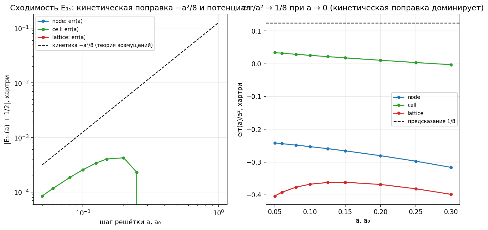

---

## Приложение. Файлы

```
src/checkerboard.py             — правило материи (шахматная доска Фейнмана)
src/dirac3d.py                  — правило материи в 3+1D: автомат Дирака/Вейля
                                  (Бялыницкий-Бирула, раздел 9)
scripts/run_extensions.py       — все эксперименты этого отчёта (30 проверок)
scripts/run_dirac3d.py          — 3+1D автомат Дирака: дисперсия, причинность,
                                  удвоение, Zitterbewegung (20 проверок)
scripts/run_lattice_correction.py — разложение поправки решётки к E₁ₛ (раздел 10)
results/extensions/ext1_dirac_dispersion.png   — дисперсия правила
results/extensions/ext2_zitterbewegung.png     — Zitterbewegung (2m)
results/extensions/ext3_proton_front.png       — фронт поля и статика
results/extensions/ext4_deuterium.png          — BBN дейтерия
results/extensions/ext5_neutrino.png           — осцилляции нейтрино (анализ)
results/extensions/proton_field.gif            — анимация свободного протона
results/extensions/atom_interaction.gif        — анимация взаимодействия p–e
results/extensions/neutrino_oscillation.gif    — анимация осцилляций нейтрино
results/extensions/report.json                 — все числа
results/dirac3d/d1_dispersion.png, d2_packet.png, d3_zitter.png, report.json
results/correction/c1_lattice_correction.png, report.json
```

Словарь «небытовых» понятий с анимациями — в отдельном документе
`GLOSSARY.md` (термины простыми словами + анимации/схемы).

Запуск: `python scripts/run_extensions.py` (~1 минута);
`python scripts/run_dirac3d.py` (~2 минуты);
`python scripts/run_lattice_correction.py` (~5 минут).
